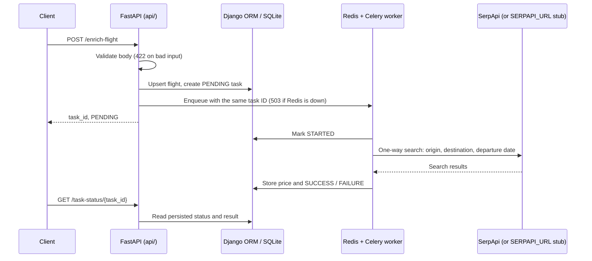

# Flight data enrichment service

A flight-price enrichment prototype combining FastAPI, Django ORM, Celery and Redis. Submit a flight, receive a task ID, and read its persisted status. A worker searches SerpApi's Google Flights endpoint for the same route and date and stores the first `best_flights` price in USD.

**A route/date search result is not a verified fare for the submitted itinerary.** The worker does not match flight numbers, legs or cabin class. This distinction matters more than the framework list when evaluating the project.

## Components and workflow



- `api/` holds the FastAPI routes, request validation and UTC normalisation.
- `backend/flights/` owns the models, migrations, the Celery task and two list pages (`/flights/`, `/flights/tasks/`).
- The task row in the database, not a Celery result backend, is the source of truth for status, so `/task-status` works after a worker restart.

Design choices worth knowing:

- **One-way search.** The worker sends SerpApi's `type=2` (one-way) with the departure date. It does not treat the arrival time as a return date.
- **Retries only where they can help.** Network errors, HTTP 429 and provider 5xx are retried up to three times with backoff (60 s, 120 s, 240 s). A 4xx, invalid JSON, a negative or non-numeric price, an unknown flight or a missing `SERPAPI_KEY` fail at once.
- **No price is not a failure.** A search with no `best_flights` ends as `SUCCESS` with `retail_price: null` and a `detail` note, and the flight stays `enriched: false`.
- **Nothing secret is stored or logged.** Stored errors are fixed messages without provider URLs or exception text, and httpx request logging is held at WARNING because SerpApi URLs carry the API key.
- **Timestamps.** Naive timestamps are taken as UTC; offset timestamps are converted to UTC. Arrival may not precede departure.

There is no currency conversion, response cache, authentication or rate limiting.

## Run it with Docker Compose

Requires Docker with Compose v2. From the repository root:

```sh
cp .env.example .env          # optional; leave SERPAPI_KEY empty unless you mean to spend quota
docker compose up --build
```

This starts the official `redis:8-alpine` image, a one-shot `migrate` step, the API on <http://127.0.0.1:8000> (OpenAPI docs at `/docs`), the Celery worker, and the Django list pages on <http://127.0.0.1:8001/flights/>. All of them share one SQLite file on the `data` volume. `docker compose down -v` removes the stack and the data.

`DEBUG` defaults to `true` in Compose, which gives Django a throwaway signing key per process. Set a private `SECRET_KEY` for anything beyond local use.

Without `SERPAPI_KEY`, submitted tasks end as `FAILURE` with `"SERPAPI_KEY is not configured"` and no request leaves the machine. To exercise the full path without a key or any spending, set `SERPAPI_URL` to a local stub that returns SerpApi-shaped JSON (see the examples below).

## Run it without Docker

Python 3.12 (see `.python-version`) and a reachable Redis. From the repository root:

```sh
python3.12 -m venv .venv
source .venv/bin/activate
python -m pip install -r requirements.txt
cp .env.example .env
python backend/manage.py migrate
```

Then, in separate terminals with the environment active:

```sh
PYTHONPATH=backend celery -A backend worker --loglevel=info
uvicorn api.main:app --host 127.0.0.1 --port 8000
python backend/manage.py runserver 127.0.0.1:8001   # optional list pages and admin
```

Settings come from the root `.env` (Django settings, the API and the worker all load it); variables already set in the shell take precedence.

| Variable | Default | Purpose |
| --- | --- | --- |
| `DEBUG` | `false` | `true` allows running without `SECRET_KEY` |
| `SECRET_KEY` | none | Django signing key; required when `DEBUG` is off |
| `SERPAPI_KEY` | none | Provider key; tasks fail fast without it |
| `SERPAPI_URL` | `https://serpapi.com/search.json` | Provider endpoint; point it at a stub for demos |
| `REDIS_URL` | `redis://127.0.0.1:6379/0` | Celery broker |
| `SQLITE_PATH` | `backend/db.sqlite3` | Database file |
| `ALLOWED_HOSTS` | `localhost,127.0.0.1,testserver` | Hosts the Django pages answer to |

## API examples

These were captured from the Compose stack with `SERPAPI_URL` pointing at a local stub that returns a fixed fixture: `best_flights` prices 289 and 342 for JFK to LAX, and no results for JFK to SFO. The prices are fixture values, not real fares.

Submit a flight:

```http
POST /enrich-flight
Content-Type: application/json

{
  "id": "synthetic-jfk-lax",
  "travel_class": "Economy",
  "origin": "JFK",
  "destination": "LAX",
  "departure_time": "2027-01-02T10:00:00Z",
  "arrival_time": "2027-01-02T16:00:00Z",
  "flight_numbers": ["DEMO1"],
  "legs": [],
  "last_seen": "2027-01-01T00:00:00Z"
}
```

```http
HTTP/1.1 200 OK

{"task_id":"c553dc3b-682c-40af-8392-66447f903e6e","status":"PENDING"}
```

Poll the task:

```http
GET /task-status/c553dc3b-682c-40af-8392-66447f903e6e

HTTP/1.1 200 OK

{"task_id":"c553dc3b-682c-40af-8392-66447f903e6e","status":"SUCCESS","result":{"retail_price":289.0}}
```

A route with no priced results (same body, `"id": "synthetic-jfk-sfo"`, `"destination": "SFO"`):

```http
HTTP/1.1 200 OK

{"task_id":"dceebd7a-0203-4517-96aa-4e435efbb89a","status":"SUCCESS","result":{"retail_price":null,"detail":"No price in provider results"}}
```

Invalid input is rejected before anything is stored (`"origin": "New York"`):

```http
HTTP/1.1 422 Unprocessable Entity

{"detail":[{"type":"string_pattern_mismatch","loc":["body","origin"],"msg":"String should match pattern '^[A-Z]{3}$'","input":"New York","ctx":{"pattern":"^[A-Z]{3}$"}}]}
```

An unknown task returns `404 {"detail":"Task not found"}`. If Redis is unreachable at submit time, the task row is marked `FAILURE` and the API answers `503 {"detail":"Unable to enqueue enrichment"}`.

## Tests and lint

```sh
python -m pip install -r requirements-dev.txt
pytest
ruff check . && ruff format --check .
```

The suite has 43 tests that use temporary SQLite databases. They cover the routes through FastAPI's `TestClient`, validation, UTC handling, the worker's retry and failure paths against a faked httpx client, the list pages, and the logging guard. No test contacts Redis or SerpApi. pytest is configured in `pyproject.toml` (`pytest-django`, settings `backend.test_settings`).

## Remaining engineering work

- Authenticate submission, status and list views and scope task visibility before hosting. A public submission route can consume provider quota.
- Match the exact itinerary and cabin rather than the first route/date result.
- Use immutable job input snapshots or version checks: two jobs for the same flight share mutable flight data.
- Add an outbox/idempotency design. Database writes and broker delivery are separate, so a crash between them can leave a PENDING row with no queued job.
- Move off SQLite once concurrent writers matter; it is shared by the API, worker and pages here only because the load is a demo's.

The FlyFlat exercise PDF in the repository root is the original assignment brief.
