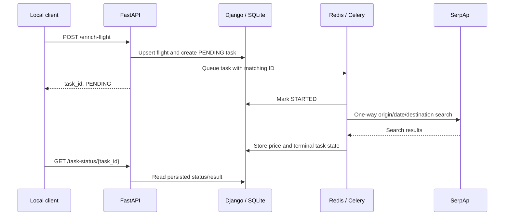

# Flight data enrichment service

A flight-price enrichment prototype combining FastAPI, Django ORM, Celery and Redis. Submit a flight, receive a task ID, and read its persisted status. A worker searches SerpApi's Google Flights endpoint and stores the first `best_flights` price in USD.

**A route/date search result is not a verified fare for the submitted itinerary.** The worker does not match flight numbers, legs or cabin class. This distinction matters more than the framework list when evaluating the project.

## Components and workflow



`api/` contains validation and HTTP routes. `backend/flights/` owns models, migrations, worker and two simple list pages. The worker uses [SerpApi's documented one-way parameter](https://serpapi.com/google-flights-api), rather than treating arrival time as a round-trip return date. There is no currency conversion, response cache, authentication or client rate limiting.

## Local setup

Use Python 3.11+ and an existing local Redis instance. From the repository root:

```sh
python3 -m venv .venv
source .venv/bin/activate
python -m pip install -r requirements.txt
cp .env.example .env
python backend/manage.py migrate
```

The example enables local `DEBUG` with a process-local random signing key. For persistent Django sessions or any non-debug use, configure a private `SECRET_KEY`. Set `SERPAPI_KEY` locally only when deliberately testing billable provider searches. `REDIS_URL` configures the broker; the default is loopback. No database, login account, session or provider credential is bundled.

Start these separately, from the root with the environment active:

```sh
# Terminal 1: Celery can locate the nested Django project
PYTHONPATH=backend celery -A backend worker --loglevel=info

# Terminal 2: HTTP API and generated /docs
uvicorn api.main:app --reload --host 127.0.0.1 --port 8000

# Optional Django list pages/admin, separate port
python backend/manage.py runserver 127.0.0.1:8001
```

Configuration is loaded from root `.env` by Django settings, the API and the worker; existing shell variables take precedence.

## Example API input

Submit synthetic data to `POST /enrich-flight`:

```json
{
  "id":"synthetic-flight",
  "travel_class":"Economy",
  "origin":"JFK",
  "destination":"LAX",
  "departure_time":"2027-01-02T10:00:00Z",
  "arrival_time":"2027-01-02T16:00:00Z",
  "flight_numbers":["DEMO1"],
  "legs":[],
  "last_seen":"2027-01-01T00:00:00Z"
}
```

A successful enqueue returns `{"task_id":"<generated UUID>","status":"PENDING"}`. Queue failure marks the stored task failed and returns 503. `GET /task-status/{task_id}` returns persisted `status` and `result`, or 404. When a price exists, a synthetic success result can look like `{"retail_price":123.45}`. These examples are not real fares or provider-verified itineraries. Naive timestamps are assumed UTC; offset timestamps are converted to UTC.

## Verification

With `DEBUG=true` exported and the root on `PYTHONPATH`:

```sh
PYTHONPATH=.:backend python backend/manage.py test flights
python -m pytest api/test_main.py -q
```

Twenty Django tests pass using temporary test databases, including mocked one-way provider parameters, price validation, persistence and queue-failure handling. Two pure timestamp tests pass. The original 16 Django tests also passed on Django 5.2; the expanded 20-test run used Django 4.2 and FastAPI from the isolated verification environment. No Redis worker, SerpApi request or production database was exercised. Requirements remain unpinned; a reproducible environment is still needed before deployment.

## Remaining engineering work

- Authenticate submission/status/list views and scope task visibility before hosting. A public submission route can consume provider quota.
- Match the exact itinerary and cabin, distinguish missing prices from successful enrichment, and validate dates/airports more strictly.
- Use immutable job input snapshots or version checks: two jobs for the same flight currently share mutable flight data.
- Add an outbox/idempotency design. Database writes and broker delivery are separate, so process crashes or ambiguous broker responses can leave inconsistent state.
- Review retry/failure state transitions, add production monitoring, and move beyond SQLite only when concurrent use requires it.

Provider requests have a 30-second timeout. Stored errors omit provider URLs and exception details; generic exceptions also hide diagnostics, so controlled redacted logging is a future improvement. The assessment PDF and license remain as existing project context; unsupported production claims have been removed.
